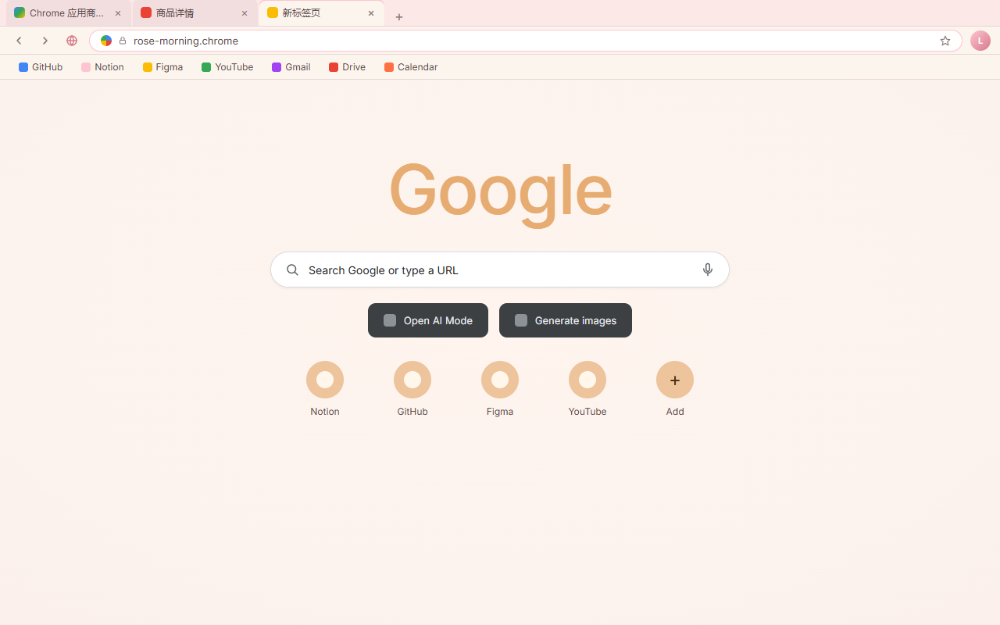
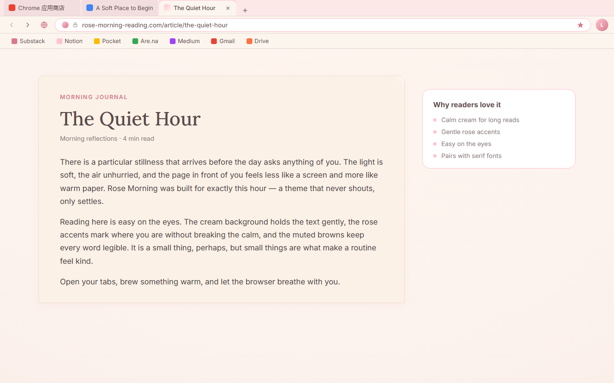

<p align="center">
  
</p>

<h1 align="center">Rose Morning Theme</h1>

<p align="center">A gentle and elegant Chrome theme inspired by cream paper, soft rose tones, and warm morning light.</p>

<p align="center">
  
  
  
</p>

## About

Rose Morning wraps your browser in a quiet morning room. A soft blush-pink window frame carries the tab strip, a warm cream-white toolbar sits beneath it, and the active tab glows in a light rose tint, so Chrome feels calm and cozy without ever competing with the pages you open. A gentle pink accent marks the omnibox border, buttons and links, while soft dark-brown ink keeps every label readable on those light surfaces. All layers are flat solid colour — no wallpaper, no textures, no gradients — and incognito windows switch to a deeper rose frame so they stay easy to tell apart.

## Color Palette

| Token | Hex | Usage |
|-------|-----|-------|
| Cream | `#FCF5EE` | Toolbar and new-tab page background |
| Blush | `#FBE8E7` | Window frame, buttons |
| Light Rose | `#F7DDDE` | Active tab |
| Petal Pink | `#FFC4D0` | Accent: omnibox border, button highlights |
| Rose Deep | `#D67A8C` | Links, toolbar icon hover |
| Soft Brown | `#5C4A4A` | Tab, toolbar, omnibox and new-tab text |
| Muted Brown | `#8C7878` | Inactive tab text, secondary UI |

## Chrome UI Notes

Chrome itself draws a few parts of the window, so they are not controlled by the theme:

- New-tab page keeps Chrome's standard full-colour Google logo, so the installed theme matches the store screenshots.
- Search box, microphone and Lens buttons on the new-tab page.
- Shortcut tiles, which follow your own browsing data.
- Chrome's own UI such as the star, ⋮ menu and download icons.
- Window buttons (minimize / maximize / close), which follow the operating system.

## Features

- Soft warm rose palette: cream toolbar, blush frame, light rose active tab, gentle pink accents.
- Pure colour theme — no images, no wallpapers, no gradients, just clean elegance.
- Comfortable contrast tuned for readable everyday browsing.
- Matching incognito colours with a deeper rose frame.
- Clean, distraction-free new-tab page.
- Pure theme: no scripts, no permissions, nothing collected.

## Install

### From source (unpacked)

1. Download or clone this repository.
2. Open Chrome and navigate to `chrome://extensions`.
3. Enable **Developer mode** in the top-right corner.
4. Click **Load unpacked** and select this folder.

### From Chrome Web Store

Search for **Rose Morning Theme** in the Chrome Web Store and install it.

## Preview



*Cream toolbar, blush frame and a light rose active tab around a clean new-tab page.*



*The same soft rose window chrome around a calm reading session.*

## Files

| File | Description |
|------|-------------|
| `manifest.json` | Chrome theme manifest (MV3) with inline `theme` config — single source of truth for every colour |
| `icon.png` | Chrome Web Store icon (128×128), referenced by `manifest.json` |
| `store-assets/icon.png` | Same 128x128 icon kept alongside the other store assets |
| `store-assets/screenshots/en/` | Store listing screenshots (1280x800) |
| `store-assets/promo/` | Promo tiles (440x280 and 1400x560) |
| `store-assets/store-description.txt` | Store listing detailed description (English) |
| `scripts/` | Generators: icon, promo tiles, screenshots, upload zip |
| `scripts/mockups/` | HTML mockups rendered by the screenshot script |

## Packaging

```
python3 scripts/package.py
```

Writes `dist/rose-morning-theme-<version>.zip` containing only `manifest.json` and `icon.png`, and copies it to the default upload folder next to the project.

## License

Non-Commercial License — personal use permitted, commercial use requires permission. See [LICENSE](LICENSE).
